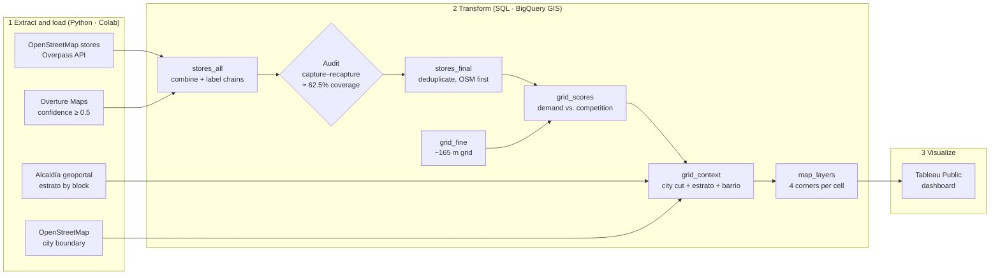

# Barranquilla Discount Grocery Stores Analysis
 
**Where should a discount grocery chain (D1, Ara, Isimo) open its next stores in Barranquilla?**
 
This location-intelligence project is built on open geospatial data: two independent store sources (OpenStreetMap and Overture Maps), a capture–recapture audit of their coverage, a grid-based white-space model in BigQuery GIS, socioeconomic context from Barranquilla's official *estrato* map, and an interactive Tableau Public dashboard.
 
**Interactive dashboard:** [Tableau Public link](https://public.tableau.com/shared/QY75M6XST?:display_count=n&:origin=viz_share_link)
 
**Google Colab notebook:** [Google Colab link](https://colab.research.google.com/drive/1It78y-lk1LzTwTmeAtuKkvDD0hmQiQ__?usp=sharing)
 
---
 
## Table of contents
1. [Business question](#business-question)
2. [Key findings](#key-findings)
3. [Dashboard](#dashboard)
4. [ELT pipeline](#elt-pipeline)
   - [How the white-space model works](#how-the-white-space-model-works)
5. [Data quality audit](#data-quality-audit-capturerecapture)
6. [Limitations](#limitations)
7. [Licenses and attribution](#licenses-and-attribution)
---
 
## Business question
 
Discount grocery stores (DGS) compete directly with the small independent stores (*tiendas de barrio*) that serve daily demand in Colombian neighborhoods. Because discount chains have operational and logistics advantages over these small stores, areas with many small stores and no discount store nearby are expansion opportunities. A good location has:
 
- **High everyday demand:** many small independent stores nearby (a proxy for foot traffic and household density).
- **Low direct competition:** no discount store (D1, Ara, Isimo) within walking distance.
- **A matching customer profile:** mostly estrato 1–3 households, the core discount-grocery customer. In my experience, many middle- and upper-income households also shop at discount stores to save money, so estrato 4–6 areas shouldn't be ruled out completely.
The project finds the parts of the city where all three conditions are true.
 
## Key findings
 
The white space forms two zones in the south of the city. Each zone groups neighboring barrios, and the values are averages of their white-space cells:
 
| # | Zone (around…) | Average estrato | Small stores within 500 m | Discount stores within 1 km |
|---|---|---|---|---|
| 1 | Simón Bolívar – Santa Helena | 2.1–2.2 | 10.0–13.0 | 0 |
| 2 | Villa Sevilla – Los Girasoles | 1.5 | 8.7–11.5 | 0 |
 
**Overall patterns**
- Discount chains already cover almost all of Barranquilla. Most of the city is within 1 km of a D1, Ara or Isimo.
- The real white space is a few small pockets in the **south**, all estrato 1–2, which is the strongest fit for a discount format.
- About **62.5% of the estimated chain stores** appear in at least one open source (see the audit below), so every "no discount store" result should be confirmed on the ground or in Google Maps before any decision.
**Study area:** bounding box lon −74.90 to −74.74, lat 10.88 to 11.06 (Barranquilla, Soledad and nearby areas).
 
## Dashboard
 
The main map is a seamless grid of ~165 m cells over Barranquilla, drawn semi-transparent over a street basemap and colored by class:
 
| Class | Rule | Meaning |
|---|---|---|
| White space | 0 discount stores within 1 km, 5+ small stores within 500 m | Demand and no competition |
| Low demand | 0 discount stores within 1 km, 0–4 small stores within 500 m | No competition, little demand |
| Covered | 1+ discount stores within 1 km | Already served |
 
## ELT pipeline
 

 
### How the white-space model works
 
1. **Grid:** 12,840 cells of 0.0015° (~165 m) over the study area, built with `GENERATE_ARRAY`.
2. **Scores:** for each cell center, the independent stores within 500 m (demand) and the discount stores within 1 km (competition), using `ST_DWITHIN`.
3. **Classes:** each cell is labeled White space, Low demand or Covered (see the table above).
4. **City cut:** cells are kept only if their center is inside the Barranquilla boundary (`ST_COVERS`). Cells over the river and the Ciénaga are dropped: they have no official block within 300 m and no small store within 500 m.
5. **Context:** the average estrato of the official blocks within 500 m ("No aplica" blocks are skipped, so purely commercial or industrial areas show as Non-residential), and the barrio of the nearest named block.
6. **Map table:** each cell becomes 4 corner rows, so Tableau can draw it as a filled polygon.
## Data quality audit (capture–recapture)
 
No open source lists every store, so I estimated how complete the data is with the **capture–recapture method**, a technique from wildlife ecology. OSM and Overture act as two independent "captures" of the same population of chain stores. A store found in both is a "recapture" (same chain, within 100 m).
 
**SQL query used:**
```sql
WITH n_counts AS (
SELECT COUNTIF(source = 'osm') as n1,
 COUNTIF(source = 'overture') as n2
FROM `geo_retail.stores_all`
WHERE chain_type IN ('Discount', 'Big Chain')
),
 
m_counts AS (
SELECT
  COUNT(DISTINCT o.store_id) AS m --This is m_osm
FROM `geo_retail.stores_all` o
JOIN `geo_retail.stores_all` v
  ON ST_DWITHIN(o.geom, v.geom, 100)
 AND o.chain = v.chain
WHERE o.source = 'osm'
  AND v.source = 'overture'
  AND o.chain_type IN ('Discount', 'Big Chain')
),
 
estimate AS (
  SELECT n1, n2, m,
  n1 * n2 / m AS n,
  n1 + n2 - m AS unique_stores_id
  FROM n_counts CROSS JOIN m_counts
)
 
SELECT 
 n1, n2, m,
 ROUND(n, 1) AS n_estimated,
 ROUND(estimate.unique_stores_id, 1) AS unique_stores,
ROUND(estimate.unique_stores_id / n, 3) AS coverage
FROM estimate 
```
 
| Measure | Value |
|---|---|
| Chain stores in OSM (n1) | 155 |
| Chain stores in Overture (n2) | 63 |
| Found in both (m) | 33 |
| Estimated total chain stores (N̂) | **≈ 296** |
| Combined unique chain stores | 185 (62.5% of the estimate) |
 
**Capture–recapture (Lincoln–Petersen) estimate formula:**
 
**N̂ = (n₁ × n₂) / m**
 
## Limitations
 
- **Coverage:** open data captures an estimated 62.5% of chain stores, and coverage of small independent stores is likely even lower.
- **Demand proxy:** the count of small stores stands in for demand. It doesn't measure population, income or foot traffic directly.
- **Estrato coverage:** the estrato map covers Barranquilla only. Soledad and nearby municipalities have no estrato data here.
- **Snapshot in time:** stores open and close. Results reflect the date the data was downloaded.
- **Unmodeled factors:** street-level foot traffic, household density and local crime rates all matter for a real expansion decision, but they aren't captured by this analysis.
- **City limit:** the boundary comes from OpenStreetMap, not from an official Alcaldía layer.
## Licenses and attribution
 
- **OpenStreetMap:** © OpenStreetMap contributors, available under the [Open Database License (ODbL) 1.0](https://opendatacommons.org/licenses/odbl/1-0/). Derived store tables in this repo are shared under the same license.
- **Overture Maps Places:** [Overture Maps Foundation](https://docs.overturemaps.org/attribution/). Mixed licenses by source (CDLA Permissive 2.0, Apache 2.0, CC0), attributed as required.
- **Estratificación:** Alcaldía Distrital de Barranquilla, Geoportal *miciudad.barranquilla.gov.co*. Downloaded manually through the public query page, at low volume. The district's open data policy publishes open data under CC BY 4.0.
This is a portfolio project for analysis practice. It isn't affiliated with any of the retail chains named.
 
---
 
**Author:** César Arrauth · Data Analyst · Industrial Engineer · Barranquilla, Colombia · [LinkedIn](https://www.linkedin.com/in/c%C3%A9sar-arrauth)
