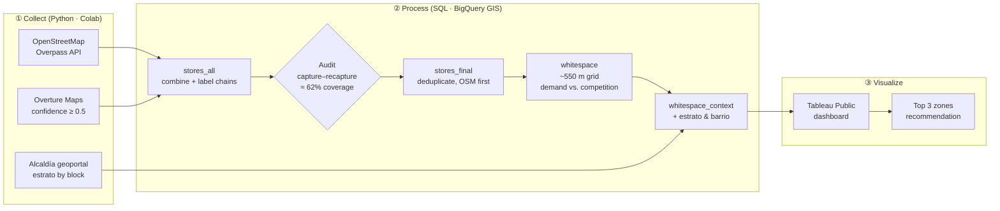

# Barranquilla Discount Grocery Analysis

**Interactive dashboard:** [Tableau Public link](https://public.tableau.com/shared/QY75M6XST?:display_count=n&:origin=viz_share_link) 

## Pipeline

## Licenses and attribution

- **OpenStreetMap:** © OpenStreetMap contributors, available under the [Open Database License (ODbL) 1.0](https://opendatacommons.org/licenses/odbl/1-0/). Derived store tables in this repo are shared under the same license.
- **Overture Maps Places:** [Overture Maps Foundation](https://docs.overturemaps.org/attribution/). Mixed licenses by source (CDLA Permissive 2.0, Apache 2.0, CC0), attributed as required.
- **Estratificación:** Alcaldía Distrital de Barranquilla, Geoportal *miciudad.barranquilla.gov.co*.  The district's open data policy publishes open data under CC BY 4.0.

This is a portfolio project for analysis practice. It isn't affiliated with any of the retail chains named.

---

**Author:** César Arrauth · Data Analyst, Barranquilla, Colombia · _[LinkedIn]_ · _[GitHub]_
