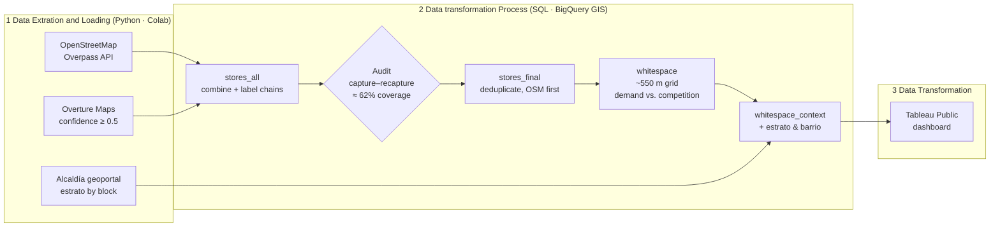

# Barranquilla Discount Grocery Stores Analysis

**Where should a discount grocery chain (D1, Ara, Isimo) open its next stores in Barranquilla?**

This location-intelligence project is built on open geospatial data: two independent store sources (OpenStreetMap and Overture Maps), a capture–recapture audit of their coverage, a grid-based white-space model in BigQuery GIS, socioeconomic context from the Barranquilla's official *estrato* map, and an interactive Tableau Public dashboard.

**Interactive dashboard:** [Tableau Public link](https://public.tableau.com/shared/QY75M6XST?:display_count=n&:origin=viz_share_link) 

**Google Colab Notebook:** [Google link](https://colab.research.google.com/drive/1It78y-lk1LzTwTmeAtuKkvDD0hmQiQ__?usp=sharing) 


---

## Table of contents
1. [Business question](#business-question)
2. [Key findings](#key-findings)
3. [ELT Pipeline](#elt-pipeline)
4. [Data quality audit](#data-quality-audit-capturerecapture)
5. [Limitations](#limitations)
6. [Licenses and attribution](#licenses-and-attribution)

---

## Business question

Discount Grocery Stores (DGS) compete directly with the neighborhoods small independent stores that serve daily demand in Colombian neighborhoods. Also, considering that DGS have operational and logistic competetive advantage against small stores, those places where are many small stores and there is not DGS presence, is an opportunity of expansion.


- **High everyday demand:** many small independent stores nearby (a proxy for foot traffic and household density).
- **Low direct competition:** no discount store (D1, Ara, Isimo) within walking distance.
- **A matching customer profile:** mostly estrato 1–3 households, the core discount-grocery customer.

The project finds the parts of the metro area where all three conditions are true.

 


## Key findings

Top 3 neighborhoods which have the most small stores and no discount grocery within a 1km 

| # | Zone (around…) | Average Estrato | Small stores within 500 m | Discount stores within 1 km |
|---|---|---|---|---|
| 1 | _Simón Bolívar_ | _2.2_ | _16_ | 0 |
| 2 | _Ciudadela 20 de julio_ | _1.6_ | _7_ | 0 |
| 3 | _José Antonio Galán_ | _2_ | _5_ | 0 |

**Overall patterns**
- The densest white-space cluster is in the south, around **Soledad**. It has many small stores and no discount store within 1 km. The city's estrato map doesn't cover Soledad (a separate municipality), so this zone is shown as "Outside Barranquilla".
- In Barranquilla itself, the white-space cells in the **east and southeast are mostly estrato 1–2**, the strongest fit for a discount format.
- A northern cluster falls in **estrato 4–6**. It has demand, but its customer profile fits a supermarket better than a hard discounter. However, in my experience, despite belonging to a middle-high socioeconomic class, many people in this group would still consider buying from a discount grocery store to save money. So this cluster may still deserve a closer look.
- About **62% of the estimated chain stores** appear in at least one open source (see the audit below), so the "no discount store" result should be confirmed on the ground and on Google Maps before any decision.


**Study area:** bounding box lon −74.90 to −74.74, lat 10.88 to 11.06 (Barranquilla, Soledad and nearby areas).

## ELT Pipeline




## Data quality audit (capture–recapture)

No open source lists every store, so I estimated how complete the data is with **capture–recapture method**, a method from wildlife ecology. OSM and Overture act as two independent "captures" of the same population of chain stores. A store found in both is a "recapture" (same chain, within 100 m).

**SQL query used:**
```sql
WITH n_counts AS (
SELECT COUNTIF(source = 'osm') as n1,
 COUNTIF(source = 'overture') as n2
FROM `geo_retail.stores_all`
WHERE chain_type IN ('Discount', 'Big Chain')
),

m_counts AS (
SELECT
  COUNT(DISTINCT o.store_id) AS m --This is m_osm
FROM `geo_retail.stores_all` o
JOIN `geo_retail.stores_all` v
  ON ST_DWITHIN(o.geom, v.geom, 100)
 AND o.chain = v.chain
WHERE o.source = 'osm'
  AND v.source = 'overture'
  AND o.chain_type IN ('Discount', 'Big Chain')
),

estimate AS (
  SELECT n1, n2, m,
  n1 * n2 / m AS n,
  n1 + n2 - m AS unique_stores_id
  FROM n_counts CROSS JOIN m_counts
)

SELECT 
 n1, n2, m,
 ROUND(n, 1) AS n_estimated,
 ROUND(estimate.unique_stores_id, 1) AS unique_stores,
ROUND(estimate.unique_stores_id / n, 3) AS coverage
FROM estimate 
```


| Measure | Value |
|---|---|
| Chain stores in OSM (n1) | 155 |
| Chain stores in Overture (n2) | 63 |
| Found in both (m) | 33 |
| Estimated total chain stores (result) | **Aprrox. 296**  |
| Combined unique chain stores | 185 ( 62.5% of the estimate) |

**Capture Recapture (Lincoln–Petersen) Estimate formula:**
$$
\hat{N} = \frac{n_1 \cdot n_2}{m}
$$


## Limitations

- **Coverage:** open data captures an estimated approx. 62% of chain stores, and independent small stores are likely even less complete.
- **Demand proxy:** the count of small stores stands in for demand. It doesn't measure population, income or foot traffic directly.
- **Estrato coverage:** the estrato map covers Barranquilla only. Soledad and nearby municipalities have no estrato data here.
- **Snapshot in time:** stores open and close. Results reflect the download dates above.
- **Unmodeled factors:** Street-level foot traffic, household density, and local crime rates all matter and are important for real location expansion but aren´t captured by this analysis.


## Licenses and attribution

- **OpenStreetMap:** OpenStreetMap contributors, available under the [Open Database License (ODbL) 1.0](https://opendatacommons.org/licenses/odbl/1-0/). Derived store tables in this repo are shared under the same license.
- **Overture Maps Places:** [Overture Maps Foundation](https://docs.overturemaps.org/attribution/). Mixed licenses by source (CDLA Permissive 2.0, Apache 2.0, CC0), attributed as required.
- **Estratificación:** Alcaldía Distrital de Barranquilla, Geoportal *miciudad.barranquilla.gov.co*. Downloaded manually through the public query page, at low volume. The district's open data policy publishes open data under CC BY 4.0. 


This is a portfolio project for analysis practice. It isn't affiliated with any of the retail chains named.

---

**Author:** César Arrauth - Data Analyst - Industrial Engineer, Barranquilla, Colombia · [LinkedIn](https://www.linkedin.com/in/c%C3%A9sar-arrauth)